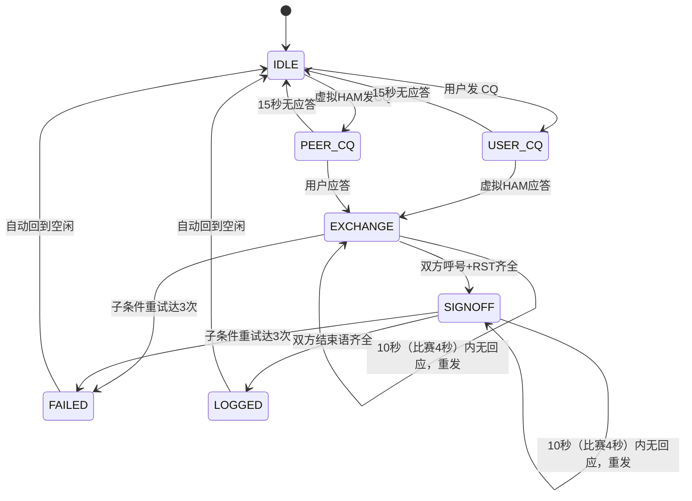

# 通联过程（报文格式与 QSO 状态机）

> 对应设计目标的第二块：通联过程——双方交换的**报文格式**，以及把它变成状态转移的**QSO 状态机**。
> 相关：报文的「语义解析」与呼号校验见 [报文解析](./MESSAGE-PARSING.md)；虚拟 HAM 的生成与运行时行为见 [虚拟 HAM 策略](./VIRTUAL-HAM.md)；音频环境见 [音频与电磁环境](./AUDIO-ENVIRONMENT.md)；界面见 [界面](./UI.md)。

---

## 报文格式规范（可解析的文本格式）

> 这是状态机与虚拟 HAM 共同遵守的「语言」。报文解析见 [报文解析](./MESSAGE-PARSING.md)。

### 通用报文结构

```text
[接收方] [[DE] 发送方] [消息] [{[PSE] K|K|BK|SK}]
```

规则：

- 接收方可以是 `CQ`
- 发送方永远是自己的呼号
- 接收方永远在发送方前面
- 对方不知道自己呼号时，必须带上接收方呼号
- 已知双方呼号时，可省略
- `PSE K` 一般只在 CQ 用
- 后续通联用 `K` 或 `BK`，甚至不发
- `BK` 表示建议后续省略呼号（虚拟 HAM 在标准格式中以此向对方确认「可省略呼号」）
- `SK` 是明确结束标志，实际发报连写为 `...-.-`
- `SK` 和 `<SK>` 都统一识别为 `SK`
- `CQ` 通常重复三遍（`CQ CQ CQ`）。解析时**先对连续重复的 `CQ` 去重**为一个，再判定 `to` / `from`，否则 `CQ CQ CQ DE BG7XXX…` 会被误判为发送方是 `CQ`（见 [报文解析](./MESSAGE-PARSING.md)）

> 注：`BK` 只是 `K` 之外的另一种结束 / 过渡选择。省略呼号的**资格**唯一取决于 `callsignsConfirmed`——用户即便从未发过 `BK` 也可省略继续通联（用户输入宽容）；而虚拟 HAM 在标准格式中会用 `BK` 向对方确认「可省略」（见下方「收发基线」）。

### 收发基线（HAM 标准 / 用户输入宽容）

本项目对「发送」与「接收」采用非对称约定，作为上方所有报文规则的总纲：

- **虚拟 HAM 一律发送标准格式**：HAM 的每一条报文都严格符合规范——该带呼号就带、该省略就省略、用 `BK` 而非 `K` 向对方确认「可省略呼号」、回复收到必带 `R`、结束语齐全。
- **用户输入宽容**：状态机对用户的解析与判定尽量宽松——用户可带可不带 `R`、可省略可不省略呼号、用 `K` 或 `BK` 均可、格式略有瑕疵也能容错；只要能可靠提取出呼号 / `RST` / 结束语语义，就照常推进状态机。

由此派生两条硬规则（HAM 侧必须遵守，用户侧不强制）：

1. **告诉对方可以省略呼号，必用 `BK`**：呼号已确认、进入可省略阶段后，HAM 交还发言权一律用 `BK`（不用纯 `K`），以明确向对方发出「可省略呼号」信号。
2. **回复收到，必用 `R`**：HAM 在回应 / 确认用户报文时，于报文起始加 `R`，表示「已抄收你的上一条」。

### 报文示例

完整一次成功 QSO（呼号交换确认后双方均省略呼号；虚拟 HAM 每条回复以 `R` 确认收到）：

```text
CQ CQ CQ DE BG7XXX BG7XXX PSE K
BG7XXX DE JA1ABC K
JA1ABC DE BG7XXX R UR RST 599 599 BK
R UR RST 599 BK
R TU 73 SK
R TU 73 SK
```

逐行说明与要点：

- 第 1 行：用户发 CQ（`USER_CQ`）。
- 第 2 行：虚拟 HAM 应答，**给出本方呼号 `JA1ABC` 并回显用户呼号 `BG7XXX`**——这是 HAM 对收到用户呼号的**首次确认**，此后 `callsignsConfirmed = true`，双方均可省略呼号；此时仍在完整呼号模式，故用 `K` 交还发言权、不带 `R`（首次应答 CQ）。
- 第 3 行：用户 `R` 确认收到 + 交换双方 RST（`UR RST 599 599`）+ `BK` 交还发言权（用户侧亦可用 `BK` 提议省略）。
- 第 4 行：虚拟 HAM `R` 确认收到、回报 RST，并以 `BK` 向用户确认「可省略呼号」（`callsignsConfirmed` 已为真，故省略呼号）。
- 第 5–6 行：双方各发结束语 `TU 73 SK`（均带 `R`），双方 RST + 结束语齐全 → `LOGGED`。

要点：

- 呼号在 HAM 应答（第 2 行）即双方确认；此后**双方**均可省略呼号。
- 虚拟 HAM 收到用户呼号后**至少确认一次**（第 2 行回显 `BG7XXX`），之后即可省略呼号。
- **虚拟 HAM 在「告诉对方可以省略呼号」时必用 `BK`**（第 4 行，不用纯 `K`）；用户输入宽容——用户即便用 `K` 也可省略，状态机照常处理。
- 虚拟 HAM **回应 / 确认用户报文时于起始加 `R`**（第 4、6 行）；首次应答 CQ（第 2 行）不带 `R`。用户可带可不带 `R`，状态机不强制。

#### 使用 BK 后省略呼号

呼号确认后，用 `BK` 交还发言权并可省略呼号（虚拟 HAM 侧同样以 `R` 起手）：

```text
R RST 599 BK
```

### 比赛模式下的报文

比赛（`CQWW` / `WPX`）沿用同一套报文规范，只是**多一个数字**、**少几句话**：

```text
CQ TEST BG7XXX          ← 我，24 区
JA1ABC                  ← 对方，25 区
JA1ABC 5NN 24           ← 点名 + 报告 + 我方分区（F2）
R 5NN 25                ← 对方报告 + 它的分区
TU
```

调过去应答别人的 CQ 时多一轮报名——那个台还不知道是谁在叫它：

```text
CQ TEST JA1ABC          ← 对方在叫
JA1ABC BG7XXX           ← 我：点名对方，再报自己（F4）
BG7XXX 5NN 25           ← 对方：确认叫的是我，并把报告与分区一起给全
JA1ABC 5NN 24           ← 我：报告 + 我方分区（F2）
TU
```

- **CQ 只说 `CQ TEST <呼号>`**：没有 `DE`、没有 `PSE K`、不连呼三遍。
- **报告恒为 `5NN`**：比赛里不判可读性，所有人报 599。
- **报告那一句带对方的呼号**：`JA1ABC 5NN 24` 一句话完成点名与交换，所以**主叫（Run）**时抄清呼号之后下一句就是它——这是 Run 比应答省一步的原因。**应答别人的 CQ（S&P）时那一步省不掉**：对方还不知道是谁在叫它，得先发 F4（`{THEIRCALL} {MYCALL}`），等它回 `BG7XXX 5NN 25`，再发自己的报告。
- **交换的数字紧跟在报告后面**（`5NN 24`），是一个整体的两部分，不是一个独立步骤。
- **数字的写法由发报人定**：`24` 可以发 `24`、`U4`、也可以对 5 区发 `05` 或 `T5`；补不补前导零、用不用短码都算对，收报一侧三种都认。
- **收尾只有 `TU`**：没有 `73`、没有 `SK`。状态机在比赛模式下收到 `TU` 即判通联完成——不再要求对方各发一句结束语（见下方「成功条件」）。

分区的来历、号码如何补位与写成短码、核对规则，见 [比赛模式](./CONTEST.md)。

> **呼号本身的规格**（ITU 格式、中国 `B5` 这类异地 / 便携写法、前缀表命中）不在这里重复，见 [报文解析](./MESSAGE-PARSING.md) 的「用户呼号」。

---

## QSO 状态机

### 状态定义

| 状态 | 含义 |
|---|---|
| `IDLE` | 空闲 |
| `USER_CQ` | 用户发了 CQ，等待应答 |
| `PEER_CQ` | 虚拟 HAM 发了 CQ，等待用户应答 |
| `EXCHANGE` | 呼号与 RST 交换中 |
| `SIGNOFF` | 结束语交换中 |
| `LOGGED` | 通联成功，已写日志 |
| `FAILED` | 通联失败 |

### 上下文标志

```typescript
interface QsoContext {
  myCall: string;
  peerCall: string | null;
  callsignsConfirmed: boolean;  // 双方呼号是否已明确（一旦为真即允许省略呼号）
  callsignsOmitted: boolean;    // 仅供显式记录「是否曾用 BK 省略」；省略资格的唯一判据是 callsignsConfirmed
  rstRx: string | null;         // 对方发给我的 RST
  rstTx: string | null;         // 我发给对方的 RST
  peerEndHeard: boolean;        // 是否收到对方结束语
  userEndSent: boolean;         // 是否已发出结束语
  retryCount: Record<string, number>;  // 各子条件重试次数，key 见下
}
```

`retryCount` 的 key 为子条件，各子条件**独立计数**，达到 3 即判失败：

- `CALL`：呼号错误（用户抄错对方呼号）
- `RST`：RST 不合法
- `COPY`：接收不全（虚拟 HAM 未收到用户完整报文）
- `SIGNOFF`：结束语交换缺失

### 状态转移表

> 下表描述状态机的**转移本身**。带「超时」的两行由 `timeoutFirstCall` / `timeoutResend` 实现，由 `QsoSession` 的调度器驱动（见下方「超时的实现状态」）。其余转移都在实际流程中发生。

| 当前状态 | 事件 | 条件 | 下一状态 | 动作 |
|---|---|---|---|---|
| `IDLE` | 用户发 CQ | — | `USER_CQ` | — |
| `IDLE` | 虚拟 HAM 发 CQ | — | `PEER_CQ` | 记录 `peerCall` |
| `USER_CQ` | 虚拟 HAM 应答 | — | `EXCHANGE` | 记录 `peerCall`，`callsignsConfirmed = true` |
| `USER_CQ` | （超时）15 秒无应答 | — | `IDLE` | 虚拟 HAM 不再应答 |
| `PEER_CQ` | 用户应答 | 呼号可读 | `EXCHANGE` | `callsignsConfirmed = true`，回 RST |
| `PEER_CQ` | （超时）15 秒无应答 | — | `IDLE` | 回到 `IDLE`，由虚拟 HAM 按 CQ 周期重新发起呼叫 |
| `EXCHANGE` | 收到对方报文 | 含合法呼号 | `EXCHANGE` | 更新 `peerCall`，`callsignsConfirmed = true` |
| `EXCHANGE` | 收到对方报文 | 含 RST | `EXCHANGE` | 记录 `rstRx` |
| `EXCHANGE` | 用户发送报文 | 含合法 RST，且 `rstRx` 仍为空 | `EXCHANGE` | 记录 `rstTx`，虚拟 HAM 回报 `R UR RST <它的 RST> BK` |
| `EXCHANGE` | 用户发送报文 | 含合法 RST，且 `rstRx` 已有 | `SIGNOFF` | 记录 `rstTx`，双方报告齐 → 虚拟 HAM 发 `R TU 73 SK` |
| `EXCHANGE` | 双方呼号 + RST 齐全 | — | `SIGNOFF` | — |
| `EXCHANGE` | 呼号抄错 | — | `EXCHANGE` | 虚拟 HAM 发 `QRZ? DE <本台呼号>`，`CALL` 重试 +1 |
| `EXCHANGE` | RST 不合法 | — | `EXCHANGE` | 虚拟 HAM 发 `UR RST?`（比赛里是 `NR?`），`RST` 重试 +1 |
| `EXCHANGE` | 接收不全 | — | `EXCHANGE` | 虚拟 HAM 发 `AGN?`（比赛里是 `NR?`），要求重发，`COPY` 重试 +1 |
| `EXCHANGE` | （超时）发出报文后 10 秒（比赛 4 秒）内无有效回应 | — | `EXCHANGE` | 虚拟 HAM 重发，对应子条件重试 +1 |
| `EXCHANGE` | 任一子条件重试达到 3 | — | `FAILED` | — |
| `SIGNOFF` | 收到对方结束语 | 含 TU / 73 / SK | `SIGNOFF` | `peerEndHeard = true` |
| `SIGNOFF` | 用户发送结束语 | 含 TU / 73 / SK | `SIGNOFF` | `userEndSent = true` |
| `SIGNOFF` | 双方结束语齐全 | — | `LOGGED` | —（日志由操作者手记，见下） |
| `SIGNOFF` | （超时）发出报文后 10 秒（比赛 4 秒）内无有效回应 | — | `SIGNOFF` | 虚拟 HAM 重发，`SIGNOFF` 重试 +1 |
| `SIGNOFF` | `SIGNOFF` 重试达到 3 | — | `FAILED` | — |
| `LOGGED` | — | — | `IDLE` | 清空上下文 |
| `FAILED` | — | — | `IDLE` | 清空上下文 |

### 呼号抄错的判定

> 呼号合法性（ITU 格式 + 前缀表命中）在状态机**消费 `ParsedMessage` 之前**对提取到的呼号 token 执行，规则见 [报文解析](./MESSAGE-PARSING.md) 的「呼号合法性校验」。未命中前缀表（如杜撰前缀 `QQ1ABC`）或格式非法的呼号，一律判为呼号错误、计入 `CALL` 重试并发 `QRZ?`——切勿误当作「省略呼号」处理，否则会掩盖用户的抄号错误。

呼号抄错只发生在交换呼号的早期阶段（不排除有人此时一并交换了 RST）。判定方式：在 `EXCHANGE` 阶段，当用户回复里出现既不是 `myCall` 也不是 `peerCall` 的呼号时，视为抄错。

此外，`BK` 后用户仍可带呼号，**带呼号本身不视为错误**；但若所带呼号与已确认的 `peerCall` 不一致（抄错），仍按呼号抄错处理。

现实中的虚拟 HAM 此时有三种可能反应：

- 没听到，继续自己的呼叫
- 听到了但不认为是在叫自己，保持静默
- 觉得像自己的呼号但不对，发 `QRZ?`

状态机统一按「发 `QRZ?`」建模，计入 `CALL` 重试。

### 成功条件（严格模式）

完成一次 QSO **必须双方各发送至少一句结束语**；仅互发 `K` / `BK` 不足以进入 `LOGGED`。以下全部满足才进入 `LOGGED`：

1. `callsignsConfirmed == true`
2. `rstRx != null`
3. `rstTx != null`
4. `peerEndHeard == true`
5. `userEndSent == true`

> 严格模式要求**双方都交换 RST**：即使被叫方也须回报 RST，否则 `rstRx` 或 `rstTx` 为 `null`，无法进入 `LOGGED`。上方「报文示例」已据此体现。

`LOGGED` 只表示**会话认为这次通联完成了**，它不再写日志：日志由操作者在录入行手记，与状态机是否走到 `LOGGED` 无关（见 [日志与存储](./LOG.md) 的「写入条件」）。两者是两条独立的线——状态机管空中的对答，录入行管纸面的记录。

关于结束语：

- 每方至少发送 `TU` / `73` / `SK` 之一即可
- 允许 `TU 73` 替代 `SK`
- `SK` 单独出现即可视为结束
- 未发送任何结束语的一方，不计入 `peerEndHeard` / `userEndSent`

### 比赛模式下放宽的一处

比赛（`CQWW` / `WPX`）里 `TU` 就是全部收尾：用户发出 `TU` 时状态机**直接判 `LOGGED`**，不等对方那句结束语回来——真实比赛也不会因为对方少发一句 `TU` 就作废这次通联。但**必须是 `TU`**：收尾状态里发一句 `?` 或对方的呼号，通联还在进行，不判完成（日常模式也是这个尺度）。除此之外上面五条一个字都不改：呼号仍要确认、两个报告仍要交换。

对方那一侧同样只有一句话：`TU`（见 [比赛模式](./CONTEST.md) 的「一次比赛通联」）。

### 失败条件

- 任一子条件（`CALL` / `RST` / `COPY` / `SIGNOFF`）重试达到 3 次
- `FAILED` 不写日志；状态随后回到 `IDLE`（日志本也不受影响：写不写由操作者决定）

### 重试规则

- 每个子条件（`CALL` / `RST` / `COPY` / `SIGNOFF`）独立计数，最多 3 次
- 呼号错误：虚拟 HAM 发 `QRZ? DE <本台呼号>`
- RST 不合法：虚拟 HAM 发 `UR RST?`（比赛里问 `NR?`——丢的总是那个数字）
- 接收不全：**仅发生在虚拟 HAM 接收用户报文时**——模拟信道波动导致 HAM 未抄清。一律视为整句未收到，虚拟 HAM 发 `AGN?`（比赛里发 `NR?`），要求用户全文重发；概率按难度档（新手 0% / 进阶 1% / 硬核 5%）

### 超时的实现状态

「等待」在这个项目里有两种实现方式，需要分清：

| 场景 | 实际做法 |
|---|---|
| 虚拟 HAM 发 CQ 后无人应答 | **已实现**：台上台持续呼叫——一条 CQ 发完、守听 3–8 秒、再发下一条；台不离开频段，也没有"3 分钟下线"（`ham/activity`，下一次开口的时刻由 `QsoSession` 按报文长度重新排定） |
| 用户发 CQ 后的等待 | **已实现**：2–3 台应答者按 1–5 秒的延迟开口，各自最多重呼 4 次；都不被点名就各自离场。堆叠散尽、频段重新安静后，若仍无人被点名，则见下一行的 15 秒收尾 |
| 对方发完报文后等用户回应 | **已实现**：等 10 秒（比赛模式 4 秒，`PARTNER_WAIT_MS` / `CONTEST_PARTNER_WAIT_MS`）没等到用户开口，就把上一条报文原样重发；重发 3 次（`PARTNER_REPEAT_LIMIT`）仍无人应，则结束本次通联、该台回到自己的 CQ 周期（由 `src/ui/sessionPatience.ts` 的 `Patience.servicePartnerWait` 调用状态机的 `timeoutResend`） |
| 首次呼叫 15 秒无应答 | **已实现**：用户自己的 CQ 由 `Patience.expireOwnCq` 在频段安静 15 秒后收回（`CALL_ANSWER_WAIT_MS`）。状态机里的 `timeoutFirstCall()` 保留为确定性接口（有测试覆盖其语义），应用侧走的是前者 |

上表三个常量（`CALL_ANSWER_WAIT_MS` / `PARTNER_WAIT_MS` / `PARTNER_REPEAT_LIMIT`）都是 `src/ui/sessionPatience.ts` 的模块私有常量，只用于说明取值，不供外部导入。

用户一开始发报、或关机再开机，都会把「等待用户回应」的计时重新开始——正在发报时对方不会插话，关机期间对方也不算白等。

---

## 发报即开始（何时与谁通联）

界面上没有「开始通联 / 监听 / 我发 CQ」这些按钮：**按电键就是开始**。键控模式也没有「发送完毕」——停手 1.5 秒就算这一帧说完了（载波落下、接收恢复），报文随即交给波段。会话在用户发出一条报文时，按报文内容决定它落到谁那里（`QsoSession.userSend`）：

| 发出的内容 | 谁来接 |
|---|---|
| 含 `CQ` | **谁都可以接**：从守听池里抽 2–3 台先后应答，形成堆叠（见 [虚拟 HAM 策略](./VIRTUAL-HAM.md) 的「多人应答（堆叠）」）。发 CQ 会结束之前的通联。 |
| 堆叠进行中 | 报文里点到哪台的呼号，哪台就是对象；没点到任何一台则谁也不接（各台继续等）。 |
| 已有通联在进行 | 交给这个通联的状态机——无论你调到哪里，它就是你的对手，直到双方 `73`。 |
| 通带里正有台在呼叫 | 视为应答它：从它刚才那条 CQ 开始，进入 `EXCHANGE`。 |
| 其它 | 报文照常发出去，**没有人应答**。没有提示，没有解释——真实通联就是这样。 |

两条推论：

- **呼号是选择器**：堆叠里点谁就是谁，所以抄错呼号等于叫错人（或没人理）。
- **没有「等待对方开口」这一步**：回复是在解析用户这一行的同时生成的（见上方「超时的实现状态」）。对方发完之后，才轮到「对方等用户开口」——那时才会重发与放弃。

---

## 结束符与发言权

结束符 `PSE K` / `K` / `BK` / `SK` 仅表示**交接发言权或结束通联**，不单独驱动状态转移；状态推进只由呼号、`RST`、结束语（`TU` / `73` / `SK`）驱动。因此：

- 用户在后续阶段发 `PSE K`：解析为 `end = PSE_K`，状态机按普通 `K` 处理（把发言权交回对方），不视为错误，虚拟 HAM 正常回应（虚拟 HAM 自身不会在后续阶段发 `PSE K`）。
- 单独携带 `K` / `BK` 仅影响发言权交接，不改变 `EXCHANGE` / `SIGNOFF` 的推进逻辑。

## R（收到确认）

`R` 表示"已抄收 / 理解对方上一条报文"，是 CW 通联中的常规礼貌确认。**不单独驱动状态转移**——它不携带呼号、`RST` 或结束语语义：

- 虚拟 HAM 作为标准回复，**在回应 / 确认用户报文时于起始加 `R`**。
- 用户可带可不带 `R`，状态机不强制。
- 例外：虚拟 HAM **首次应答 CQ**（给出本方呼号、建立通联的那一次）不带 `R`——那是通联起始，而非对某条已收报文的确认。
- `R` 与发言权交接符（`K` / `BK` / `SK`）互不冲突，可同时出现（如 `R TU 73 SK`、`R UR RST 599 BK`）。

---

## 两个场景：别人通联、多人应答

### HAM 之间的通联

波段上的两台虚拟 HAM 会自己按上面这套脚本通联（见 [虚拟 HAM 策略](./VIRTUAL-HAM.md) 的「互相通联（后台）」）：标准 6 行、同频、按操作者设定的速度播出。

**操作者插不进这一段**——不是协议上的限制，而是那两台正在进行 QSO，第三方的呼叫不会被受理。但这件事实**不可见**：真实情况下你也看不到别人是否在通联，只能调过去听。所以界面不给任何提示，在这个频率上发 CQ 也不会被拒绝——CQ 照常出去，只是**没有人应答**，那两台继续把 6 行说完。等它们 `73 SK` 之后，原来那个呼叫方**隔几秒会重新呼叫 CQ**，这时候应答它才是正常路径；或者换一个频率。

### 堆叠中的点名

多台同时应答时（见 [虚拟 HAM 策略](./VIRTUAL-HAM.md) 的「多人应答（堆叠）」），**呼号本身就是选择**：

- 用户回复中出现哪台的呼号，哪台就是通联对象；`JA1ABC DE BG7XXX`、`JA1ABC 599`、`JA1ABC DE BG7XXX R UR RST 599 BK` 都算点名。
- **不带呼号的回复不推进**：`R BK` 在协议上完全合法，但没有指定对象，堆叠中没有任何一台会认领它；各台重新静默后继续等待。这不是「用户输入不宽容」，而是堆叠这一场景的核心规则。
- 点名成功后，被点中的台按「已应答的 CQ」处理：延迟 1–3 秒发 `R UR RST 599 BK`，随后进入标准交换流程（不再重发一次 `MYCALL DE HAM`，因为它刚才已经报过呼号）。
- 未被点名的台**回到守听池**：它们从未占用频段，所以不是"下线"，也不会出现在瀑布图上。

---

## 状态机图（Mermaid）


