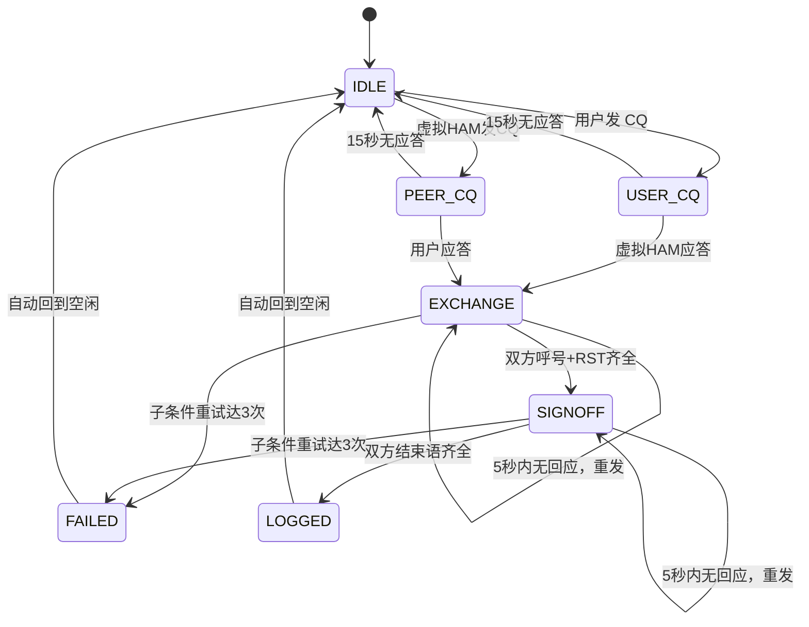

# 通联过程（QSO 协议、状态机、虚拟 HAM）

> 对应设计目标的第二块：通联过程——虚拟 HAM 的状态机、可解析的文本格式，以及支撑它们的呼号/前缀体系。
> 相关：报文的「语义解析」见 [报文解析](./MESSAGE-PARSING.md)；虚拟 HAM 策略（生成 / 前缀 / 地理 / 行为）见 [虚拟 HAM 策略](./VIRTUAL-HAM.md)；音频环境见 [音频与电磁环境](./AUDIO-ENVIRONMENT.md)；UI/范围/术语见 [UI 界面](./UI.md)。

---

## 项目目标与核心功能

### 目标

为业余无线电爱好者提供一个**离线、可交互的 CW 练习环境**，模拟真实业余无线电通联过程，帮助用户练习：

- 抄收 CW 报文
- 使用直键或 iambic 键发送 CW
- 完成标准 QSO 流程
- 记录练习通联日志

### 核心功能

- 模拟业余无线电四个 CW 频段：7 / 14 / 21 / 28 MHz
- 虚拟 HAM 随机开台、发 CQ、应答用户
- 用户通过键盘模拟直键或 iambic 发送 CW
- 辅助模式可实时显示 CW 翻译文本
- 通联成功后自动记录日志

---

## 报文格式规范（可解析的文本格式）

> 这是状态机与虚拟 HAM 共同遵守的「语言」。报文解析见 [报文解析](./MESSAGE-PARSING.md)。

### 通用报文结构

```text
[接收方] [[DE] 发送方] [消息] [{[PSE] K|K|BK|SK}]
```

规则：

- 接收方可以是 `CQ`
- 发送方永远是自己的呼号
- 接收方永远在发送方前面
- 对方不知道自己呼号时，必须带上接收方呼号
- 已知双方呼号时，可省略
- `PSE K` 一般只在 CQ 用
- 后续通联用 `K` 或 `BK`，甚至不发
- `BK` 表示建议后续省略呼号（虚拟 HAM 在标准格式中以此向对方确认「可省略呼号」）
- `SK` 是明确结束标志，实际发报连写为 `...-.-`
- `SK` 和 `<SK>` 都统一识别为 `SK`
- `CQ` 通常重复三遍（`CQ CQ CQ`）。解析时**先对连续重复的 `CQ` 去重**为一个，再判定 `to` / `from`，否则 `CQ CQ CQ DE BG7XXX…` 会被误判为发送方是 `CQ`（见 [报文解析](./MESSAGE-PARSING.md)）

> 注：`BK` 只是 `K` 之外的另一种结束 / 过渡选择。省略呼号的**资格**唯一取决于 `callsignsConfirmed`——用户即便从未发过 `BK` 也可省略继续通联（用户输入宽容）；而虚拟 HAM 在标准格式中会用 `BK` 向对方确认「可省略」（见上方「收发基线」）。

### 收发基线（HAM 标准 / 用户输入宽容）

本项目对「发送」与「接收」采用非对称约定，作为上方所有报文规则的总纲：

- **虚拟 HAM 一律发送标准格式**：HAM 的每一条报文都严格符合规范——该带呼号就带、该省略就省略、用 `BK` 而非 `K` 向对方确认「可省略呼号」、回复收到必带 `R`、结束语齐全。
- **用户输入宽容**：状态机对用户的解析与判定尽量宽松——用户可带可不带 `R`、可省略可不省略呼号、用 `K` 或 `BK` 均可、格式略有瑕疵也能容错；只要能可靠提取出呼号 / `RST` / 结束语语义，就照常推进状态机。

由此派生两条硬规则（HAM 侧必须遵守，用户侧不强制）：

1. **告诉对方可以省略呼号，必用 `BK`**：呼号已确认、进入可省略阶段后，HAM 交还发言权一律用 `BK`（不用纯 `K`），以明确向对方发出「可省略呼号」信号。
2. **回复收到，必用 `R`**：HAM 在回应 / 确认用户报文时，于报文起始加 `R`，表示「已抄收你的上一条」。

### 报文示例

完整一次成功 QSO（呼号交换确认后双方均省略呼号；虚拟 HAM 每条回复以 `R` 确认收到）：

```text
CQ CQ CQ DE BG7XXX BG7XXX PSE K
BG7XXX DE JA1ABC K
JA1ABC DE BG7XXX R UR RST 599 599 BK
R UR RST 599 BK
R TU 73 SK
R TU 73 SK
```

逐行说明与要点：

- 第 1 行：用户发 CQ（`USER_CQ`）。
- 第 2 行：虚拟 HAM 应答，**给出本方呼号 `JA1ABC` 并回显用户呼号 `BG7XXX`**——这是 HAM 对收到用户呼号的**首次确认**，此后 `callsignsConfirmed = true`，双方均可省略呼号；此时仍在完整呼号模式，故用 `K` 交还发言权、不带 `R`（首次应答 CQ）。
- 第 3 行：用户 `R` 确认收到 + 交换双方 RST（`UR RST 599 599`）+ `BK` 交还发言权（用户侧亦可用 `BK` 提议省略）。
- 第 4 行：虚拟 HAM `R` 确认收到、回报 RST，并以 `BK` 向用户确认「可省略呼号」（`callsignsConfirmed` 已为真，故省略呼号）。
- 第 5–6 行：双方各发结束语 `TU 73 SK`（均带 `R`），双方 RST + 结束语齐全 → `LOGGED`。

要点：

- 呼号在 HAM 应答（第 2 行）即双方确认；此后**双方**均可省略呼号。
- 虚拟 HAM 收到用户呼号后**至少确认一次**（第 2 行回显 `BG7XXX`），之后即可省略呼号。
- **虚拟 HAM 在「告诉对方可以省略呼号」时必用 `BK`**（第 4 行，不用纯 `K`）；用户输入宽容——用户即便用 `K` 也可省略，状态机照常处理。
- 虚拟 HAM **回应 / 确认用户报文时于起始加 `R`**（第 4、6 行）；首次应答 CQ（第 2 行）不带 `R`。用户可带可不带 `R`，状态机不强制。

#### 使用 BK 后省略呼号

呼号确认后，用 `BK` 交还发言权并可省略呼号（虚拟 HAM 侧同样以 `R` 起手）：

```text
R RST 599 BK
```

---

## 用户呼号

- 必须填写
- 统一大写
- 允许虚拟格式，如 `BG7XXX`、`B5`
- 不校验呼号是否在现实中存在
- 校验分两步：先符合 **ITU 呼号格式**（见下），再确认前缀命中**枚举的前缀表**（`data/dxcc.json`）
- 允许 `/P`、`/M`、`/QRP`、`/5` 等操作后缀
- **只判定格式合法性，不记录、不展示该呼号属于哪个国家 / 地区**（延续去争议化原则）

### ITU 呼号格式

ITU 呼号由「国家 / 地区前缀 + 数字 + 后缀」构成，分两种基本格式：

- 格式一：1 个字符 + 1 位数字 + 1–4 个字母的后缀
- 格式二：2 个字符 + 1 位数字 + 1–4 个字母的后缀

约束：

- 前 1–2 个字符是国家 / 地区标识（如中国为 `B`）
- 中国的典型结构为 `B` + 电台种类字母 + 分区数字 + 后缀，例如 `BG5ABC`
- 后缀由字母组成，最多 4 个；部分国家用后缀首字母 / 长度区分执照等级（如澳大利亚标准呼号后缀为 3 字母，首字母限 H / L / M / N / P / V）
- 呼号后可加 `/` + 操作状态标识（`/M` 移动、`/P` 便携、`/AM` 航空移动、`/MM` 海上移动，以及 `/5` 这类分区数字），这不是呼号本身的一部分
- 禁止使用可能被误认为遇险信号的组合（例如以数字开头且第二字符为 `O` 或 `I`）

#### 中国异地 / 便携呼号（易漏写的情况）

- 美国 / 日志类呼号用**后缀**表示异地，例如 `W1AW/5`（在 5 区操作）。
- 中国用**前缀**表示异地：在 `B` 后直接跟分区数字，**可省略后继字母后缀**，例如 `B5`、`B1`。`B` + 数字 也属合法（虽少见）。
- 因此 `B5`、`B1`、`B5ABC` 这类「`B` 起头、数字后无（或少量）字母」的呼号同样是合法的，校验时不应判为非法。
- 注意：这与 `/5` 后缀式是**同一语义的不同写法**，两者都允许；本项目只判格式合法，不区分、不记录其国家 / 地区。

### 呼号正则

```regex
^[A-Z]{1,2}[0-9][A-Z]{0,4}(/[A-Z0-9]{1,4})?$
```

> 后缀字母改为可选（`[A-Z]{0,4}`），以容纳中国 `B5` 这类无后继字母的异地 / 便携呼号；`/` 操作后缀（如 `/P`、`/M`、`/QRP`、`/5`）仍允许。

示例（均合法）：

- `BG7XXX`（中国，标准）
- `B5`（中国，异地 / 便携，无后缀）
- `B1`、`B5ABC`（中国，`B` + 数字，少见但合法）
- `JA1ABC`（日本）
- `VR2XXX`（香港）
- `W1AW`（美国）
- `BG7XXX/P`、`JA1ABC/QRP`、`W1AW/5`（带操作后缀）

> 校验分两步：
> 1. **格式**：按上方正则确认整体格式（前缀为字母、含一位数字、后缀字母可选）。
> 2. **前缀表**：从呼号提取「字母前缀」（首个数字前的字母，并先去掉 `/...` 操作后缀），该字母前缀必须命中 [`data/dxcc.json`](../data/dxcc.json) 的 `prefixes` 全集——要么精确等于某个 token，要么是其首部子串（如 `B` 是 `BA` / `BD` / `BG` / ... 的首部）。仅格式正确、但前缀不在表中（如 `ZZ1ABC`、`QQ1` 等杜撰前缀）仍视为非法。
>
> 我们**只判定格式合法性，不记录、不展示该呼号属于哪个国家 / 地区**（延续去争议化原则）。收紧后的正则同时排除了 `599` 这类全数字被误判为呼号的情况。

> 呼号前缀表、位置推断、虚拟 HAM 生成策略（优先权 / 权重 / 生成算法）与呼号后缀生成，统一见 [虚拟 HAM 策略](./VIRTUAL-HAM.md)。

---

## QSO 状态机

### 状态定义

| 状态 | 含义 |
|---|---|
| `IDLE` | 空闲 |
| `USER_CQ` | 用户发了 CQ，等待应答 |
| `PEER_CQ` | 虚拟 HAM 发了 CQ，等待用户应答 |
| `EXCHANGE` | 呼号与 RST 交换中 |
| `SIGNOFF` | 结束语交换中 |
| `LOGGED` | 通联成功，已写日志 |
| `FAILED` | 通联失败 |

### 上下文标志

```typescript
interface QsoContext {
  myCall: string;
  peerCall: string | null;
  callsignsConfirmed: boolean;  // 双方呼号是否已明确（一旦为真即允许省略呼号）
  callsignsOmitted: boolean;    // 仅供显式记录「是否曾用 BK 省略」；省略资格的唯一判据是 `callsignsConfirmed`（呼号已交换确认）——无论之前用 `K` 还是 `BK`，只要 `callsignsConfirmed` 为真即可省略呼号，本字段不额外放宽资格
  rstRx: string | null;         // 对方发给我的 RST
  rstTx: string | null;         // 我发给对方的 RST
  peerEndHeard: boolean;        // 是否收到对方结束语
  userEndSent: boolean;         // 是否已发出结束语
  retryCount: Record<string, number>;  // 各子条件重试次数，key 见下
}
```

`retryCount` 的 key 为子条件，各子条件**独立计数**，达到 3 即判失败：

- `CALL`：呼号错误（用户抄错对方呼号），仅 `EXCHANGE` 阶段计
- `RST`：RST 不合法，仅 `EXCHANGE` 阶段计
- `COPY`：接收不全（虚拟 HAM 未收到用户完整报文），仅 `EXCHANGE` 阶段计
- `SIGNOFF`：结束语交换缺失（发出结束语后 5 秒内对方无有效结束语回应），仅 `SIGNOFF` 阶段计

### 状态转移表

| 当前状态 | 事件 | 条件 | 下一状态 | 动作 |
|---|---|---|---|---|
| `IDLE` | 用户发 CQ | — | `USER_CQ` | 启动 15 秒应答等待 |
| `IDLE` | 虚拟 HAM 发 CQ | — | `PEER_CQ` | 启动 15 秒用户应答等待 |
| `USER_CQ` | 虚拟 HAM 应答 | — | `EXCHANGE` | 记录 `peerCall` |
| `USER_CQ` | 15 秒无应答 | — | `IDLE` | 虚拟 HAM 不再应答 |
| `PEER_CQ` | 用户应答 | — | `EXCHANGE` | 记录 `peerCall` |
| `PEER_CQ` | 15 秒无应答 | — | `IDLE` | 回到 `IDLE`，由虚拟 HAM 按 CQ 周期重新发起呼叫（见下方首次呼叫等待） |
| `EXCHANGE` | 收到对方报文 | 含合法呼号 | `EXCHANGE` | 更新 `peerCall`，`callsignsConfirmed = true` |
| `EXCHANGE` | 收到对方报文 | 含 RST | `EXCHANGE` | 记录 `rstRx` |
| `EXCHANGE` | 用户发送报文 | 含合法 RST | `EXCHANGE` | 记录 `rstTx` |
| `EXCHANGE` | 双方呼号 + RST 齐全 | — | `SIGNOFF` | — |
| `EXCHANGE` | 呼号抄错（用户回复的呼号与 `peerCall` 不一致） | — | `EXCHANGE` | 虚拟 HAM 发 `QRZ?`（或 `QRZ? DE <本台呼号>`），`CALL` 重试 +1 |
| `EXCHANGE` | RST 不合法 | — | `EXCHANGE` | 虚拟 HAM 发 `UR RST?`，`RST` 重试 +1 |
| `EXCHANGE` | 接收不全 | — | `EXCHANGE` | 虚拟 HAM 发 `?` 或 `AGN?`，要求全文重发，`COPY` 重试 +1 |
| `EXCHANGE` | 发出报文后 5 秒内无有效回应 | — | `EXCHANGE` | 虚拟 HAM 重发，对应子条件重试 +1 |
| `EXCHANGE` | 任一子条件重试达到 3 仍无有效回应 | — | `FAILED` | — |
| `SIGNOFF` | 收到对方结束语 | 含 TU / 73 / SK | `SIGNOFF` | `peerEndHeard = true` |
| `SIGNOFF` | 用户发送结束语 | 含 TU / 73 / SK | `SIGNOFF` | `userEndSent = true` |
| `SIGNOFF` | 双方结束语齐全 | — | `LOGGED` | 写日志 |
| `SIGNOFF` | 发出报文后 5 秒内无有效回应 | — | `SIGNOFF` | 虚拟 HAM 重发，`SIGNOFF` 重试 +1 |
| `SIGNOFF` | `SIGNOFF` 重试达到 3 仍无有效回应 | — | `FAILED` | — |
| `LOGGED` | — | — | `IDLE` | 清空上下文 |
| `FAILED` | — | — | `IDLE` | 清空上下文 |

### 呼号抄错的判定

> 呼号合法性（ITU 格式 + 前缀表命中 [`data/dxcc.json`](../data/dxcc.json)）的校验，在状态机**消费 `ParsedMessage` 之前**对提取到的呼号 token 执行。未命中前缀表（如杜撰前缀 `ZZ1ABC`）或格式非法的呼号，一律判为呼号错误、计入 `CALL` 重试并发 `QRZ?`——切勿误当作「省略呼号」处理，否则会掩盖用户的抄号错误。

呼号抄错只发生在交换呼号的早期阶段（不排除有人此时一并交换了 RST）。判定方式：在 `EXCHANGE` 阶段，当用户回复的接收方 / 发送方呼号与已确认的 `peerCall` 不一致时，视为抄错。

此外，`BK` 后用户仍可带呼号，**带呼号本身不视为错误**；但若所带呼号与已确认的 `peerCall` 不一致（抄错），仍按呼号抄错处理（计 `CALL` 重试、发 `QRZ?`）。

虚拟 HAM 此时通常认为这并不是在呼叫自己，行为分三种（具体选用见 [虚拟 HAM 策略](./VIRTUAL-HAM.md)）：

- 没听到，继续自己的呼叫
- 听到了但不认为是在叫自己，保持静默，等待用户与其他电台完成通联
- 觉得像自己的呼号但不对，发 `QRZ?` 或 `QRZ? DE <本台呼号>`

状态机统一按「发 `QRZ?`」建模，计入 `CALL` 重试。

### 成功条件（严格模式）

完成一次 QSO **必须双方各发送至少一句结束语**；仅互发 `K` / `BK` 不足以进入 `LOGGED`。以下全部满足才进入 `LOGGED`：

1. `callsignsConfirmed == true`
2. `rstRx != null`
3. `rstTx != null`
4. `peerEndHeard == true`
5. `userEndSent == true`

> 严格模式要求**双方都交换 RST**：即使被叫方也须回报 RST，否则 `rstRx` 或 `rstTx` 为 `null`，无法进入 `LOGGED`。上方「报文示例」已据此体现——虚拟 HAM 在第 4 行回报 RST、并与用户各发结束语，最终满足全部 5 项条件进入 `LOGGED`；同时展示了「呼号确认后省略」与「虚拟 HAM 以 `R` 确认收到」两项约定。

关于结束语：

- 每方至少发送 `TU` / `73` / `SK` 之一即可
- 允许 `TU 73` 替代 `SK`
- `SK` 单独出现即可视为结束
- `TU 73` 是可选的礼貌用语
- 未发送任何结束语的一方，不计入 `peerEndHeard` / `userEndSent`

### 失败条件

- 任一子条件（`CALL` / `RST` / `COPY` / `SIGNOFF`）重试达到 3 次
- 用户主动调谐离开当前 QSO（如果实现）

失败不写日志，状态回到 `IDLE`。

### 超时与重发规则

在 `EXCHANGE` / `SIGNOFF` 阶段，任意一方发出报文后启动 **5 秒**等待：

- 5 秒内未收到对方有效回应 → **重发**该报文（或重发提示），对应子条件重试次数 +1
- 同一子条件连续 **3 次**重发仍无有效回应 → 认为对方已离开，状态回到 `IDLE`（不写日志）

> 这与首呼等待不同：首呼（用户发 CQ 等 HAM 应答、或 HAM 发 CQ 等用户应答）是一次性等待（见下），不触发重发。

首次呼叫等待（CQ）：

| 场景 | 超时时间 | 行为 |
|---|---|---|
| 用户发 CQ 后无应答 | 15 秒 | 虚拟 HAM 不再应答，用户回到 `IDLE` |
| 虚拟 HAM 发 CQ 后用户无应答 | 15 秒 | 虚拟 HAM 回到 CQ 周期，继续发 CQ |
| 虚拟 HAM CQ 连续无应答 | 3 分钟 | 虚拟 HAM 下线，从频率消失 |

### 重试规则

- 每个子条件（`CALL` / `RST` / `COPY`）独立计数，最多 3 次
- 呼号错误：虚拟 HAM 发 `QRZ?`（或 `QRZ? DE <本台呼号>`）
- RST 不合法：虚拟 HAM 发 `UR RST?`
- 接收不全：**仅发生在虚拟 HAM 接收用户报文时**——模拟环境有几率出现信号波动导致 HAM 未抄清。一律视为整句未收到，虚拟 HAM 发 `?` 或 `AGN?`，要求用户全文重发

> 实现提示：所有等待定时器（15s 首呼、5s 重发、3min HAM 下线）须在状态切换与上下文清空时妥善清理——进入新状态前清除上一状态待触发的定时器；`LOGGED` / `FAILED` → `IDLE` 时清空全部定时器与 `retryCount`。

---

### 结束符与发言权

结束符 `PSE K` / `K` / `BK` / `SK` 仅表示**交接发言权或结束通联**，不单独驱动状态转移；状态推进只由呼号、`RST`、结束语（`TU` / `73` / `SK`）驱动。因此：

- 用户在后续阶段发 `PSE K`：解析为 `end = PSE_K`，状态机按普通 `K` 处理（把发言权交回对方），不视为错误，虚拟 HAM 正常回应（见虚拟 HAM 行为约束：其自身不会在后续阶段发 `PSE K`）。
  - 单独携带 `K` / `BK` 仅影响发言权交接，不改变 `EXCHANGE` / `SIGNOFF` 的推进逻辑。

### R（收到确认）

`R` 表示"已抄收 / 理解对方上一条报文"，是 CW 通联中的常规礼貌确认。**不单独驱动状态转移**——它不携带呼号、`RST` 或结束语语义，仅作为接收确认随报文出现：

- 虚拟 HAM 作为标准回复，**在回应 / 确认用户报文时于起始加 `R`**。
- 用户可带可不带 `R`，状态机不强制，解析与状态推进不受影响。
- 例外：虚拟 HAM **首次应答 CQ**（给出本方呼号、建立通联的那一次）不带 `R`——那是通联起始，而非对某条已收报文的确认。
- `R` 与发言权交接符（`K` / `BK` / `SK`）互不冲突，可同时出现（如 `R TU 73 SK`、`R UR RST 599 BK`）。

### 堆叠中的点名

多发一台同时应答时（见 [虚拟 HAM 策略](./VIRTUAL-HAM.md) 的「多人应答（堆叠）」），**呼号本身就是选择**：

- 用户回复中出现哪台的呼号，哪台就是通联对象；`JA1ABC DE BG7XXX`、`JA1ABC 599`、`JA1ABC DE BG7XXX R UR RST 599 BK` 都算点名。
- **不带呼号的回复不推进**：`R BK` 在协议上完全合法，但没有指定对象，堆叠中没有任何一台会认领它；各台重新静默后继续等待。这不是「用户输入不宽容」，而是堆叠这一场景的核心规则。
- 点名成功后，被点中的台按「已应答的 CQ」处理：延迟 1–3 秒发 `R UR RST 599 BK`，随后进入标准交换流程（不再重发一次 `MYCALL DE HAM`，因为它刚才已经报过呼号）。
- 未被点名的台离场：临时生成的台下线，原本就在波段上的台回到守听。

## 虚拟 HAM 行为

> 虚拟 HAM 的运行时行为（CQ 节奏、应答延迟、接收不全、行为约束、多人应答）与呼号抄错时的三种反应，统一见 [虚拟 HAM 策略](./VIRTUAL-HAM.md)，由 QSO 状态机在其各阶段调用。

---

## 状态机图（Mermaid）


